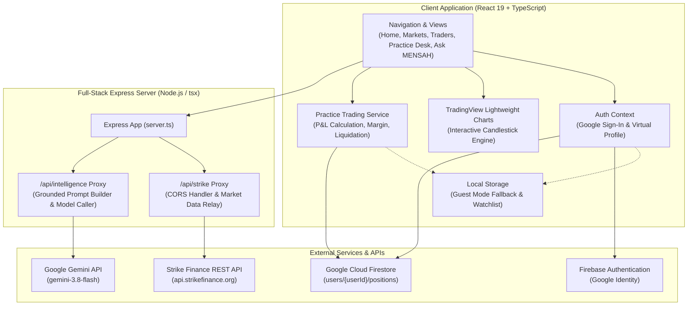

# MENSAH — Intelligent Trading Analytics & Copy-Trader Simulation

MENSAH is an intelligent trading analytics and copy-trading simulation platform built around the Strike Finance perpetual trading ecosystem. Designed for both newcomers and seasoned market participants, MENSAH provides a transparent, risk-free environment to explore live perpetual contracts, evaluate lead trader strategies, simulate practice trades using a persistent $10,000 virtual balance, and ask questions to a plain-English AI assistant.

---

## Table of Contents
1. [Project Overview](#1-project-overview)
2. [The Problem](#2-the-problem)
3. [Our Solution](#3-our-solution)
4. [Key Features](#4-key-features)
5. [How MENSAH Works](#5-how-mensah-works)
6. [Technology Stack](#6-technology-stack)
7. [System Architecture](#7-system-architecture)
8. [Data Sources and Data Integrity](#8-data-sources-and-data-integrity)
9. [Current Implementation Status](#9-current-implementation-status)
10. [Safety and Simulation Disclaimer](#10-safety-and-simulation-disclaimer)
11. [Getting Started](#11-getting-started)
12. [Project Scope](#12-project-scope)
13. [Acknowledgements and License](#13-acknowledgements-and-license)

---

## 1. Project Overview

MENSAH transforms complex decentralized perpetual futures data into accessible, actionable insights. By interfacing with Strike Finance's on-chain pricing feeds and trader performance histories, the application enables users to:
- Monitor live market prices, funding conditions, open interest, and 24-hour volume.
- Inspect professional candlestick charts powered by TradingView's Lightweight Charts engine with zoom and pan controls.
- Evaluate lead traders through objective risk metrics, 30-day equity curves, win rates, and volatility warnings.
- Practise paper trading directly with a persistent $10,000 virtual balance on live market feeds.
- Simulate copy-trading allocations to understand drawdown, slippage, and potential gains before risking any personal capital.
- Consult **Ask MENSAH**, an educational AI assistant that translates jargon (like Long, Short, Leverage, and Liquidation) into plain English.

> **Important Notice:** MENSAH is strictly an analytics and simulation platform. It is **not** an automated trading bot, does not hold custodial funds, and **does not execute real financial transactions** or live on-chain smart contract orders.

---

## 2. The Problem

Decentralized perpetual trading presents steep barriers to entry:
1. **Intimidating Terminology:** Concepts like "unrealized P&L", "funding rates", "drawdown spikes", and "cross-margin liquidation" confuse beginners and obscure risk.
2. **Opaque Trader Metrics:** Marketing figures often highlight massive percentage returns while hiding catastrophic volatility or 80%+ drawdown risks that would wipe out small portfolios.
3. **High Cost of Learning:** In perpetual markets, learning through trial and error with real money frequently results in immediate liquidation and lost capital.
4. **Lack of Verifiable Simulation:** Most paper-trading platforms rely on fake, randomized price feeds that do not reflect actual live market conditions, spreads, or genuine price action.

---

## 3. Our Solution

MENSAH bridges the gap between decentralized perpetual protocols and everyday traders through four pillars:
- **Verified Market Feeds:** Real perpetual prices and statistics proxied directly from the Strike Finance ecosystem.
- **Transparent Risk Profiling:** Graphical radial scores, risk bar gauges, and automated 24-hour volatility spike detection.
- **Dual Practice Modes:**
  - *Solo Practice Trading:* Long and Short paper positions with custom leverage, stop-loss, and take-profit controls.
  - *Strategy Simulation:* Replaying and tracking virtual allocations against lead trader execution models.
- **Grounded Educational Intelligence:** "Ask MENSAH" provides contextual guidance on active practice trades and live charts using Google's Gemini models (`gemini-3.8-flash`).

---

## 4. Key Features

### 📊 Real-Time Market Intelligence
- **Live Ticker Stream:** Top perpetual pairs (`BTC-USD`, `ETH-USD`, `SOL-USD`, `ARB-USD`, `LINK-USD`, `AVAX-USD`) displaying current mark prices, 24-hour percentage changes, volume, and open interest.
- **Interactive Candlestick Charts:** TradingView Lightweight Charts integration with multi-timeframe support (`1m`, `5m`, `15m`, `1h`, `4h`, `1d`), crosshairs, price tooltips, mouse-wheel zooming, trackpad panning, and one-click "Reset Zoom" controls.
- **Data Status Badging:** Explicit indicators showing data freshness, update timestamps, and connection status.

### 🔍 Trader Discovery & Analytics
- **Multi-Factor Filtering:** Search and filter lead traders by protocol, trading style (Scalper, Swing, Trend, High-Frequency), risk tier (Conservative, Moderate, Aggressive, High Risk), minimum Copy Score, and watchlist status.
- **Traceable Performance Metrics:** 30-day return, net profit/loss, win rate, profit factor, active days, vault balances, and historical 30-day equity wave sparklines.
- **Drawdown & Volatility Alerts:** Automatic detection of traders experiencing high 24-hour drawdown spikes (e.g. >10% in 24 hours), warning users of abrupt tail risks.

### 🎮 Virtual Practice Trading ($10,000 Starting Balance)
- **Persistent Virtual Account:** Authenticated users receive a one-time $10,000 virtual USD grant stored in Google Cloud Firestore. Balance changes persist across sessions and page refreshes.
- **Solo Practice Trading Desk:**
  - Select trading pair and position direction (**Long** for price rise, **Short** for price drop).
  - Virtual margin allocation with a dynamic leverage slider (1x to 50x) accompanied by risk amplification warnings.
  - Estimated liquidation price calculations incorporating maintenance margin buffers.
  - Stop-loss and take-profit presets (Conservative, Balanced, or custom values).
- **Trades Currently Running:** Live dashboard tab tracking active paper trades, dynamic mark-to-market current profit/loss, and a single-click **Close Practice Trade** action that atomically credits funds back to the user's virtual balance.
- **Closed-Trade History:** Chronological ledger of completed practice trades detailing exit price, duration, realized profit/loss, and close reasons (*manual*, *take_profit*, *stop_loss*, or *liquidation*).

### 🤖 Ask MENSAH — Plain-English AI Assistant
- **Beginner-Friendly Explanations:** Clarifies what candlesticks indicate, how Long and Short differ, how leverage magnifies both gains and losses, and what stop-loss orders accomplish.
- **Context-Grounded:** Answers are informed by live Strike Finance market quotes and the user's active practice positions.
- **Dual Form Factor:** Accessible as a slide-out drawer or as a dedicated full-page workspace.
- **Server-Side Security:** AI queries route through an Express proxy using the official `@google/genai` TypeScript SDK (`gemini-3.8-flash`) without exposing API keys to the browser, with an integrated client-side deterministic fallback engine.

---

## 5. How MENSAH Works

The standard user flow is simple and transparent:

```
1. Access Platform  ──►  Guest Mode or Sign In with Google
                                │
2. Virtual Balance  ──►  $10,000 Virtual USD assigned to profile (Firestore)
                                │
3. Market Research  ──►  Inspect Strike market prices & interactive candlestick charts
                                │
4. Choose Practice  ──►  ┌─────────────────────────┬─────────────────────────┐
                         ▼                         ▼                         ▼
                  Solo Practice Desk       Copy Strategy Sim        Ask MENSAH Guide
                         │                         │                         │
5. Monitor Trades   ──►  Track "Trades Currently Running" with live mark-to-market P&L
                                │
6. Close & Settle   ──►  Close Practice Trade  ──►  Virtual balance updated atomically
```

1. **Authentication:** Sign in via Google with a single click, or continue immediately in local guest mode.
2. **Virtual Balance Assignment:** Accounts are provisioned with a $10,000 virtual balance. Virtual balances are strictly simulated and cannot be deposited, withdrawn, or exchanged for real funds.
3. **Explore Markets:** View real-time price updates and inspect historical price candles across supported Strike Finance pairs.
4. **Choose Strategy:**
   - Execute solo paper trades (Long/Short) on the practice desk.
   - Or test a copy-trade simulation against a lead trader's historical profile.
5. **Monitor & Close:** Watch active positions adjust with live market movements. Click "Close Practice Trade" at any time to lock in simulated profit or loss.
6. **Learn with AI:** Ask MENSAH questions regarding any trade outcome, risk metric, or chart formation.

---

## 6. Technology Stack

| Category | Technology | Purpose |
| :--- | :--- | :--- |
| **Frontend Framework** | React 19 (`react`, `react-dom`) | Single-page application UI |
| **Language** | TypeScript 5.8+ | End-to-end type safety |
| **Build Tool & Dev Server** | Vite 8 + Express | Fast client bundling and server middleware integration |
| **Styling** | Tailwind CSS v4 (`@tailwindcss/vite`) | Modern, responsive design system |
| **Candlestick Charting** | Lightweight Charts v5.2 (TradingView) | High-performance interactive financial charts |
| **Data Visualization** | Recharts v3.10 | Sparkline equity curves, radial score gauges, and charts |
| **Icons & Motion** | `lucide-react`, `motion` (Framer Motion v12) | Interface iconography and smooth animations |
| **Authentication** | Firebase Authentication v13 (Google Provider) | Secure user login and session management |
| **Database & Persistence** | Google Cloud Firestore | Persistent virtual account balances and position records |
| **Server Backend** | Express.js v4.21 (`tsx` runtime) | Reverse proxy for Strike API and Gemini intelligence |
| **AI Model & SDK** | Google Gemini (`gemini-3.8-flash` via `@google/genai` v2.4.0) | Context-grounded plain-English assistant |
| **Data Provider** | Strike Finance REST API (`api.strikefinance.org`) | Real decentralized perpetual market data and prices |

---

## 7. System Architecture



---

## 8. Data Sources and Data Integrity

MENSAH maintains strict data integrity rules to ensure all users understand exactly where data originates:

1. **Live Perpetual Prices:**
   - Proxied directly from Strike Finance REST endpoints (`/api/strike/prices/current`, `/api/strike/markets/summary`).
   - Prices update dynamically. If the remote API becomes unreachable, the UI surfaces a clear warning rather than fabricating fake movements.
2. **Historical Candlestick Data:**
   - Candlesticks (Open, High, Low, Close) are constructed from verifiable historical time-series data and recent Strike price marks.
3. **Lead Trader Statistics:**
   - Aggregated metrics (30-day ROI, win rate, profit factor, active trading days, equity waves) are computed from public protocol track records.
   - *Limitation Note:* Strike Finance's public REST endpoints do not currently provide real-time private sub-account transaction order streams for third-party traders. Therefore, trader analytics represent verified aggregated historical performance rather than a live transaction-by-transaction mirror.
4. **Intentionally Fictional Virtual Balance:**
   - The user's $10,000 starting balance is intentionally simulated virtual capital. It carries zero monetary value and does not interact with any cryptocurrency wallet or blockchain transaction.

---

## 9. Current Implementation Status

| Feature / Subsystem | Status | Evidence & Verification in Codebase |
| :--- | :---: | :--- |
| **Market Data Proxy & Feeds** | **Working** | Implemented in `server.ts` (`/api/strike`), consumed via `src/services/strikeMarketApi.ts`. |
| **Interactive Candlestick Charts** | **Working** | Implemented in `src/components/charts/TradingViewChart.tsx` using `lightweight-charts` with zoom, pan, and timeframes. |
| **Trader Discovery & Directory** | **Working** | Implemented in `src/components/TraderCard.tsx`, `TraderTable.tsx`, and `DiscoveryFilters.tsx`. |
| **Risk & Drawdown Profiling** | **Working** | Radial score gauges (`ScoreRadialGauge.tsx`), risk bars (`RiskBarGauge.tsx`), and 24h drawdown spike alerts. |
| **Solo Practice Trading Desk** | **Working** | Implemented in `src/components/simulator/SoloPracticeDesk.tsx` with Long/Short, leverage, SL/TP, and liquidation price estimation. |
| **Running Practice Trades & History** | **Working** | Implemented in `src/components/simulator/RunningTradesSection.tsx` with mark-to-market P&L and atomic close actions. |
| **Copy-Trader Strategy Simulation** | **Working** | Implemented in `src/components/simulator/SimulationConfigForm.tsx` & `SimulationResultsDashboard.tsx`. |
| **Google Authentication** | **Working** | Implemented in `src/contexts/AuthContext.tsx` via Firebase Auth popup with guest fallback. |
| **Persistent Virtual Balances** | **Working** | Stored in Google Cloud Firestore (`users/{userId}`), initialized to $10,000, updated on closed trades. |
| **Ask MENSAH AI Assistant** | **Working** | Implemented in `server.ts` (`/api/intelligence`) using `gemini-3.8-flash` with grounded prompts and deterministic fallback. |
| **Real Live On-Chain Trade Execution** | **Not Implemented** | **By Design**: MENSAH is strictly an analytics and simulation environment; no real trades are submitted to contracts. |
| **Live Order-by-Order Copying** | **Not Implemented** | Public Strike APIs do not offer private live transaction webhooks for arbitrary lead traders. Aggregated strategy simulation is used instead. |

---

## 10. Safety and Simulation Disclaimer

> ⚠️ **Important Financial Disclaimer:**
>
> 1. **Virtual Capital Only:** All trading on MENSAH utilizes simulated virtual USD. The $10,000 virtual balance is not real currency and has no monetary value.
> 2. **No Execution Guarantee:** Simulated performance calculations are educational models. Past performance of any lead trader does not guarantee future results.
> 3. **Market Risk:** Perpetual futures involve significant financial risk, leverage amplification, and potential loss. MENSAH is designed to help users understand these risks safely before considering real trading elsewhere.
> 4. **No Financial Advice:** Nothing contained in this application or provided by the Ask MENSAH AI assistant constitutes financial, investment, legal, or tax advice.

---

## 11. Getting Started

### Prerequisites
- **Node.js:** v20.x or higher
- **npm:** v10.x or higher

### Installation

1. **Clone the repository:**
   ```bash
   git clone https://github.com/your-username/mensah.git
   cd mensah
   ```

2. **Install project dependencies:**
   ```bash
   npm install
   ```

3. **Configure Environment Variables:**
   Copy the example environment configuration:
   ```bash
   cp .env.example .env
   ```
   Open `.env` and add your Gemini API key (optional, for Ask MENSAH AI responses):
   ```env
   GEMINI_API_KEY=your_gemini_api_key_here
   ```
   *(Note: Firebase and Firestore credentials are pre-configured in `firebase-applet-config.json`.)*

4. **Run the Development Server:**
   ```bash
   npm run dev
   ```
   Open your browser and navigate to `http://localhost:3000`.

5. **Build for Production:**
   ```bash
   npm run build
   ```

6. **Start Production Server:**
   ```bash
   npm start
   ```

7. **Code Linting & Type Checking:**
   ```bash
   npm run lint
   ```

---

## 12. Project Scope

### What MENSAH Does:
- Aggregates verified Strike Finance perpetual market data.
- Renders high-fidelity candlestick charts with technical controls.
- Indexes lead traders by verifiable risk and performance metrics.
- Provides a persistent $10,000 virtual paper trading simulator for Long and Short positions.
- Models copy-trading strategies based on historical performance.
- Explains complex trading terms and user trade histories through an educational AI assistant.

### What MENSAH Does Not Do:
- Does not connect to user Web3 wallets to spend real funds.
- Does not broadcast transactions or submit orders to the Strike Finance smart contracts.
- Does not guarantee that simulated strategy outcomes will match live trading execution.
- Does not act as an automated algorithmic execution bot.

---

## 13. Acknowledgements and License

- **Market Data & Protocol:** [Strike Finance](https://docs.strikefinance.org/) perpetual trading ecosystem.
- **Charting Engine:** [Lightweight Charts](https://tradingview.github.io/lightweight-charts/) by TradingView.
- **AI Infrastructure:** [Google Gemini API](https://ai.google.dev/) (`gemini-3.8-flash`).
- **Icons & UI:** [Lucide Icons](https://lucide.dev/) and [Tailwind CSS](https://tailwindcss.com/).

### License
This repository is marked as private in `package.json` (`"private": true`). All rights reserved.
